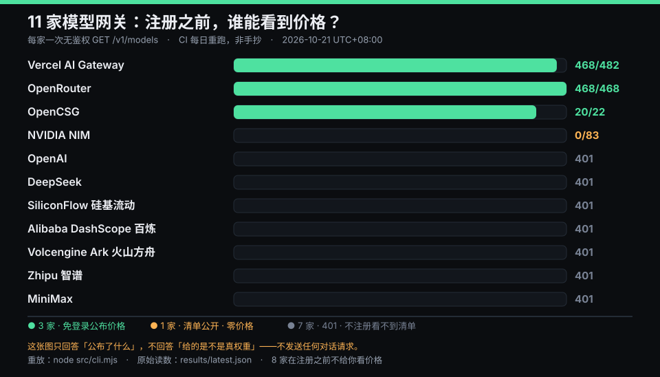

# gateway-price-check

[](https://github.com/happy520ai/gateway-price-check/actions/workflows/ci.yml)
[](https://github.com/happy520ai/gateway-price-check/actions/workflows/daily.yml)

一个只读问题：**一个 OpenAI 兼容端点，在你没注册、没 key 的时候，愿不愿意把价格告诉你？**

很多模型网关要先把账号建完、充完值，你才知道自己按什么单价付费。这个工具对任意端点发**一次无鉴权 GET**，
然后报告它公开返回了什么：有没有价格、有没有币种字段、有没有缓存价、有没有告诉你每个模型 id 背后是哪份权重。

```bash
# 不用 clone、不用装：一条命令直接跑（已实测，输出如上）
npx github:happy520ai/gateway-price-check

# 探测你自己的端点：直接粘你的 base_url 就行（.../v1 会自动补成 .../v1/models，并会打印补全后的地址）
npx github:happy520ai/gateway-price-check --url https://your-gateway.example/v1 --name mine

# 或者 clone 下来
node src/cli.mjs
node src/cli.mjs --url https://your-gateway.example/v1 --name mine
```

单文件版（不用 clone、不用装依赖）放在 gist 里，由本仓库源码机械拼接生成，文件头写明生成自哪个 commit：
[gist.github.com/happy520ai/5f5f2a95385ef185f51a42c04a99cc46](https://gist.github.com/happy520ai/5f5f2a95385ef185f51a42c04a99cc46)
— 重新生成 `node make-gist-bundle.mjs`，查是否过期 `node make-gist-bundle.mjs --check`。



下表与上面这张图都由 CI 从 `results/latest.json` 重写（`<!--READINGS:-->` 之间是机器区，手改会在下一次
每日跑批时被覆盖——覆盖不是 bug，是因为手抄的数字会在端点变动当天变成假话，而这张页面上的数字是给别人引用的）。
最新一次读数见 [RESULTS.md](RESULTS.md)。

<!--READINGS:BEGIN-->

| 判词 | 家数 | 是谁 |
|---|---|---|
| `YES` 免登录就公布价格 | **3** | OpenCSG 20/22 · OpenRouter 468/468 · Vercel AI Gateway 468/482 |
| `NO` 清单公开但一个价都不标 | **1** | NVIDIA NIM 0/83 |
| `AUTH` 不注册连清单都看不到（401） | **7** | OpenAI · DeepSeek · SiliconFlow 硅基流动 · Alibaba DashScope 百炼 · Volcengine Ark 火山方舟 · Zhipu 智谱 · MiniMax |

<!--READINGS:END-->

三条读数：

1. **11 家里只有 3 家免登录就给价格（27%）。** 所以"免登录能看价"既不是行业惯例，也不是某个品类的默认设置——
   任何拿它当独家卖点的文案都不该被相信。
2. **它跟厂商大小无关。** NVIDIA 把清单公开却一个价都不标；七家一线与国产原厂连清单都要 key。
   公开清单和公开价格是两件不同的事，混为一谈的探针会给出漂亮的假数据。
3. 三家里只有 OpenCSG 的价格对象带显式 `currency` 字段并按「元/百万 token」报。
   **这是单位可读性差异，不是透明度差异**——透明度上 OpenRouter 是 468/468，比它更高。

## 引用这些数据

`results/latest.json` 每天被覆盖，所以**不要**引用它来支撑一个带日期的说法——你点进去的时候它已经是别的日子了。
带日期的读数在 [`results/history/`](results/history/)，一天一个文件，CI 每天追加，
文件名与内容里的 `as_of` 由测试互锁（对不上就红），也不允许往回覆盖。

引用格式建议：`gateway-price-check, reading of <as_of> (UTC+08:00), results/history/<as_of>.json`。

## 它刻意不做的事

- **不发任何对话请求，因此不评估模型保真度。** 它只回答"公布了什么"，不回答"给的是不是真权重"。
  要测后者，去看 `awesome-ai-gateway` 的 canary-diff 方法。
- **不并发、不重试、不轮询。** 每个端点一次 GET。
- **不把"我没读到"说成"它没有"。** 这是本工具唯一严格的设计约束，见下。

## 五档判词、三档退出码，而不是"读不到＝没有"

（"五档"指判词 `YES`/`NO`/`AUTH`/`ERR`/`UNKNOWN`；"三档"指进程退出码 0/1/2。两个数不同源，别把它们当成同一个东西——本仓库的描述一度只写"three-tier verdicts"，那是把退出码误当判词数。）

| 退出码 | 档位 | 含义 |
|---|---|---|
| 0 | `YES` / `NO` / `AUTH` | 清单读到了；或明确被鉴权挡住（401/403）——对"免登录可见价格"这个问题，`AUTH` 就是"否" |
| 1 | `ERR` | 端点不可达 / 非 401·403 的错误 / 不是 `data[]` 清单形状 / **清单为空** |
| 2 | `UNKNOWN` | 有条目带 `pricing` 对象，但**一条都没有**字段名落在识别词表内 |

`ERR` 与 `NO` 必须分开：一个返回空数组的端点，和一个明确列出 20 个模型却一个价都不标的端点，
是两件完全不同的事。`AUTH` 也不算 `ERR`——把 401 归成"探针失灵"会**系统性高估整个行业的透明度**，
这正是我第一版犯的错，是拿 OpenAI 和 DeepSeek 真跑了一遍才暴露的。
`UNKNOWN` 存在的原因是——如果服务商把价格放在 `in_unit` 这种我们没见过的键里，
一个只会数 `prompt`/`price` 的探针会报"0 条带价"，那是**探针瞎了**，不是服务商不透明。
部分不认识时判 `YES` 并在判词里报出未解析条数与键名（Vercel 那 60 条就是这么露出来的）。

## 给 AI 助手用：MCP 服务端（stdio）

也在**官方 MCP Registry** 里：`io.github.happy520ai/gateway-price-check`（包是 `.mcpb`，stdio / node 运行时）。
在支持注册表的客户端里可以直接搜这个名字；核对用权威路由：

```
curl -s https://registry.modelcontextprotocol.io/v0/servers/io.github.happy520ai%2Fgateway-price-check/versions
```

（命名空间里有斜杠，必须编码成 `%2F`；`?search=` 那个面是缓存——0.5.6/0.5.7 发布后十几分钟，它仍返回 0.5.4。）

同一个测量，另一个入口。宿主是语言模型时，"能不能看价格"这个问题就变成它可以自己回答的事：

```json
{
  "mcpServers": {
    "gateway-price-check": {
      "command": "npx",
      "args": ["-y", "--package", "github:happy520ai/gateway-price-check", "gateway-price-check-mcp"]
    }
  }
}
```

两把工具：

- `check_price_disclosure(url, name?)` → 一次无鉴权 `GET /v1/models`，返回 `YES`/`NO`/`AUTH`/`ERR`/`UNKNOWN` + 条目数/带价数。**内部就是 fork 一份 `src/cli.mjs`**，所以 MCP 读数、CLI 读数、CI 归档读数出自同一条代码路径——两台仪器只有共享同一份声明时才算互证，共享同一段实现时才算不打架。
- `latest_archive_readings(date?)` → 读仓库里已归档的每日横评（默认今天，可给 `YYYY-MM-DD`）。

三条设计约束，都是这个入口特有的：

1. **它只准走 https，且默认拒绝环回/私网/链路本地/元数据地址。** 宿主可能被页面内容牵着走，一个"帮我探探这个端点"的请求不该变成对内网的任意请求。确实要在内网自测就显式设 `GPC_ALLOW_INSECURE=1`。
2. **`ERR`/`UNKNOWN` 不是服务商的判决，是探针的**——`initialize` 的 `instructions` 里就把这句写死，免得模型转述成"它不透明"。
3. **协议层错误与工具层失败分开**：未知方法 `-32601`、未知工具/坏参数 `-32602`、被拒绝的 URL `-32600`；真跑但读不出结果才走 `isError`。这样宿主能区分"你没资格问"和"这个问题现在没答案"。

`test/mcp.test.mjs` 真起子进程做 stdio 握手（9 条离线臂 + 1 条联网臂，CI 两个 OS 都开 `GPC_LIVE_TESTS=1`）。其中"通知不许有回包"那条自带正对照：先证明抓得到没人等的回包，再断言通知没有——否则那是一条空断言。

## 在 CI 里跑（composite GitHub Action）

不用装东西，也不用写脚本：把 `uses` 指到 release tag，一次无鉴权 GET 就进你的流水线。

```yaml
- uses: happy520ai/gateway-price-check@v0.3.0
  with:
    url: https://ai.space.opencsg.com/v1   # …/v1 或完整 …/v1/models 都行
    name: OpenCSG
    fail-on: 'NO'                          # 只有"清单公开却零价格"默认让 CI 转红
# outputs: verdict / total / priced / json
```

`fail-on` 默认是 `NO`，而 **`ERR`/`UNKNOWN` 默认不失败**——那两档说的是探针自己（网络不通、价格键长在词表外），把它们当"服务商不透明"会系统性低估行业的透明度。想让它们也拦，就显式写 `fail-on: 'NO,ERR,UNKNOWN'`。写进 `fail-on` 的词不在这五档内，action 会**拒绝执行**且不留下半截 outputs。

能照抄的真跑例子（含一条"必须红"的臂，用来证明 `fail-on` 不是装饰）：
[`.github/workflows/action-smoke.yml`](./.github/workflows/action-smoke.yml)。

## 自测

```bash
node --test
```

10 条用例里包含四条**必中靶**：空清单必须落到 `ERR`（不许落 `NO`）、全未知字段必须落到 `UNKNOWN`、
401 必须落到 `AUTH` 而 404 仍须是 `ERR`（不许把两种失败混成一档）、部分未知时判 `YES` 但判词必须带出未解析条数。
没有这四条，上面的分档承诺只是文档里的一句话。

## 加一个服务商

编辑 `src/providers.json`，或直接用 `--url`。若对方用了新字段名，把键加进 `src/probe.mjs` 顶部的
`PRICE_KEY` / `CACHE_KEY` / `UPSTREAM_KEY` 三个正则，并补一条用例。

## 披露

本仓库作者维护一个 [OpenCSG 价格实测页](https://happy520ai.github.io/opencsg-model-pricing/)，
那个页面带个人邀请码，有人经它注册我会拿到平台奖励。本工具与那份利益关系**保持隔离**：
默认配置里两个服务商是并列摆放的，而上面那张表里 **OpenRouter 的透明度读数比 OpenCSG 更高**
（468/468 带价 vs 20/22）。如果这个工具只对某一家说好话，它就没有存在价值。

MIT。
